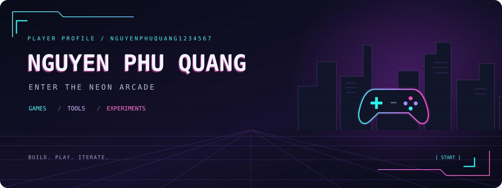

<div align="center">



# Hey, I'm Quang 👾

**Games, tools, and experiments — one project at a time.**

[Explore my repositories](https://github.com/nguyenphuquang1234567?tab=repositories) · [Browse my work](https://github.com/nguyenphuquang1234567?tab=overview)

</div>

---

### `01 / PLAYER SELECT`

I build browser games, explore alternative ways to play, and contribute to game tools. This is my corner of GitHub: fighting games, tank battles, gesture controls, and the code behind them.

```text
┌─ QUANG'S ARCADE ───────────────────────────────┐
│  GAMEPLAY     → browser combat & game systems │
│  INPUT       → webcam & gesture experiments   │
│  TOOLBOX     → game saves & asset editing     │
└──────────────────────────────────────────────┘
```

### `02 / SELECT A MISSION`

| Project | Inside the repo |
| :--- | :--- |
| **[🥊 Shadow Duel](https://github.com/nguyenphuquang1234567/shadow-duel)** | A Phaser + TypeScript browser fighting game with bot opponents, difficulty levels, and combat audio. |
| **[🚀 Tank Battle Game](https://github.com/nguyenphuquang1234567/Tank-Battle-Game)** | A two-player tank battle built with JavaScript and HTML5 Canvas. |
| **[✋ Hand Gesture Game Controller](https://github.com/nguyenphuquang1234567/Hand-Gesture-Game-Controller)** | Webcam hand tracking with MediaPipe and OpenCV, mapped to game controls. |
| **[🛠️ ktc-edit](https://github.com/nguyenphuquang1234567/ktc-edit)** | My fork of the Kingdom Two Crowns editor, with contributions to game asset editing, Campaign/Challenge support, island inspection, and Apple Silicon patches. |

### `03 / LOADOUT`

Technologies used across the projects above:

**Game development** · TypeScript · JavaScript · Phaser · HTML5 Canvas  
**Gesture controls** · Python · OpenCV · MediaPipe · PyAutoGUI  
**Desktop tools** · Tauri · SvelteKit

---

<div align="center">

**BUILD. PLAY. ITERATE.**

<sub>Welcome to the arcade. Pick a repo and press start.</sub>

</div>
